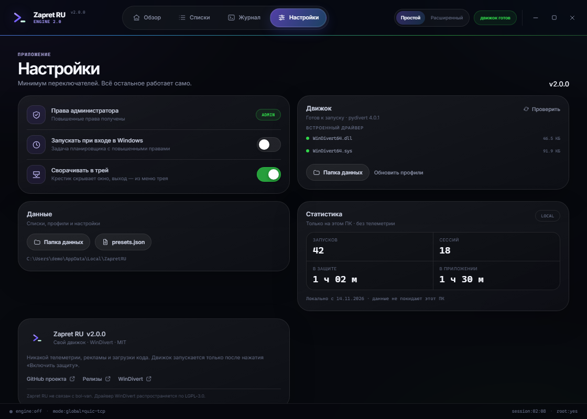
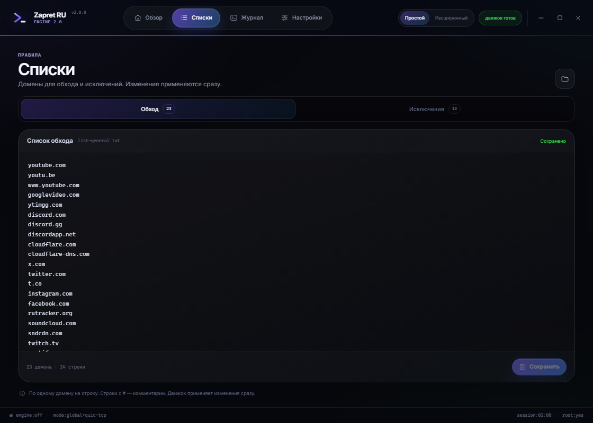
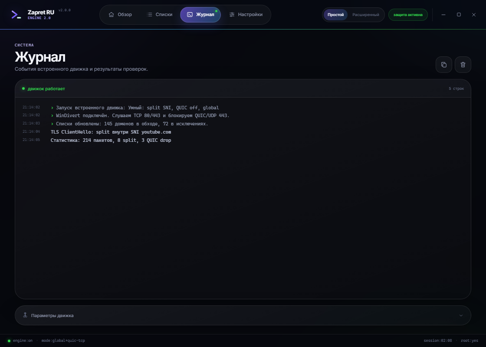
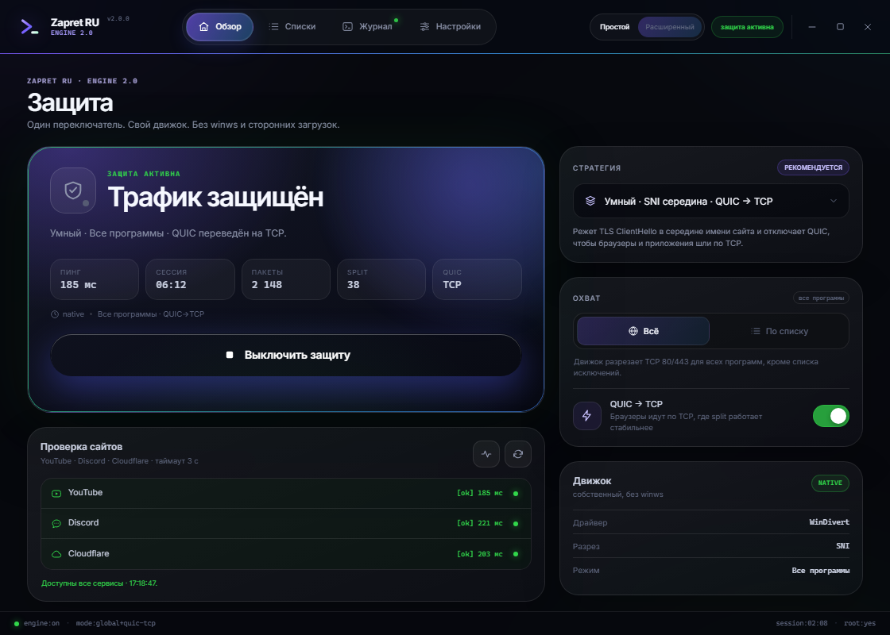

# Zapret RU

<p align="center">
  
</p>

<p align="center">
  <b>Свой DPI-движок для Windows. Один exe. Без winws и сторонних загрузок.</b><br>
  YouTube, Discord, Cloudflare и все TCP-приложения — в одном большом окне.
</p>

<p align="center">
  <a href="https://github.com/GARAKIL/zapret-ru/releases/latest"></a>
  <a href="https://github.com/GARAKIL/zapret-ru/actions/workflows/ci.yml"></a>
  
  
  
  
  
</p>

<p align="center">
  <a href="https://github.com/GARAKIL/zapret-ru/releases/latest"><b>Скачать ZapretRU.exe</b></a>
  ·
  <a href="https://github.com/GARAKIL/zapret-ru">Репозиторий</a>
  ·
  <a href="https://github.com/GARAKIL/zapret-ru/releases">Все релизы</a>
</p>

<p align="center">
  
  
</p>
<p align="center">
  
  
</p>
<p align="center">
  
</p>

**Zapret RU 2.0.0** — самостоятельный Windows-клиент для обхода DPI/ТСПУ. Внутри
собственный движок на WinDivert: он перехватывает исходящий TCP 80/443, находит
SNI в TLS ClientHello или `Host` в HTTP и разрезает первый сегмент внутри имени
сайта. Никакого `winws.exe`, `cygwin1.dll`, `.bin`-файлов и папки `bin` больше
нет. Скачал один exe — запустил — нажал одну кнопку.

> **Честно о «100%»:** ни один локальный обход DPI не работает на 100% у всех
> провайдеров. Блокировки по IP, подмена DNS, ECH и отдельные UDP-протоколы
> требуют других мер. Встроенный автоподбор честно проверяет несколько
> стратегий и выбирает лучшую для вашего подключения.

## Что нового в 2.0.0

- **Движок 2.0.** Больше не зависит от zapret и `winws.exe`. Логика SNI-split,
  HTTP Host split и QUIC → TCP написана в этом проекте, а автоподбор проверяет
  7 профилей.
- **Один файл.** `ZapretRU.exe` уже содержит интерфейс, PyDivert и подписанный
  драйвер WinDivert. Ничего не скачивается при запуске.
- **Большое окно 1120×800.** Настоящие кнопки свернуть / развернуть / закрыть,
  перетаскивание за заголовок, двойной клик по заголовку.
- **Простой и расширенный режим.** На простом экране — большая круглая кнопка,
  пинг, статистика и две вторичные кнопки. Профили и диагностика скрыты за
  переключателем «Расширенный».
- **Цельный glass-UI.** Верхнее меню вместо сайдбара, прозрачный логотип без
  подложки, крупные стеклянные панели, анимированные градиентные обводки и
  мягкие переходы. Главное действие — одна кнопка «Включить защиту».
- **7 профилей.** Добавлены «Старт SNI» и «Конец SNI» для DPI, который смотрит
  не только середину имени; автоподбор проверяет все.
- **Умный охват.** Режим «Все программы» для TCP 80/443 плюс список исключений
  для банков и госуслуг. Режим «По списку» разрезает только выбранные домены.
- **QUIC → TCP.** UDP 443 блокируется, чтобы браузеры и приложения переходили
  на TCP, где разрез SNI работает стабильнее. Отключается одним тумблером.
- **Горячее применение списков.** Сохранили список — движок сразу обновил
  политику, без перезапуска.
- **Локальная статистика.** Запуски, сессии, время в защите. Данные не покидают
  компьютер.

## Как это работает

```text
приложение → WinDivert (outbound TCP 80/443)
           → TLS ClientHello / HTTP Host
           → проверка include/exclude
           → split внутри SNI или Host
           → два TCP-сегмента, checksum пересчитан
```

- WinDivert перехватывает трафик на уровне ОС, поэтому работает для браузеров,
  Electron-приложений, игровых лаунчеров и других программ, а не только для
  одного процесса.
- Разрез делается внутри имени сайта. DPI, который смотрит только первый
  сегмент, не видит полный SNI.
- В режиме «Все программы» список исключений проверяется по SNI/Host: банки,
  госуслуги и `.ru` можно исключить.
- QUIC UDP 443 отбрасывается только когда включён тумблер «QUIC → TCP». Это
  заставляет Chrome, Edge и YouTube использовать TCP.
- Нет прокси, VPN и удалённого сервера. Пинг не увеличивается за счёт плеча
  маршрутизации; диагностика показывает реальные HTTPS-задержки.

## Быстрый старт

1. Скачайте `ZapretRU.exe` из [Releases](https://github.com/GARAKIL/zapret-ru/releases/latest).
2. Запустите и разрешите UAC — WinDivert нужен доступ к пакетам.
3. Нажмите **«Включить защиту»**.
4. Если сайт не открывается — нажмите маленькую кнопку автоподбора рядом с
   «Проверка сайтов». Приложение проверит все профили и оставит лучший.
5. Для точечного обхода переключите «Все программы» на «По списку» и отредактируйте
   список на вкладке **Списки**.

Папки `bin` и отдельных файлов zapret не требуется.

## Профили

| Профиль | Что делает |
|---|---|
| **Умный** | SNI-split в середине имени + QUIC → TCP. Рекомендуется. |
| **Старт SNI** | Разрез сразу после начала домена. Для DPI, читающего начало записи. |
| **Конец SNI** | Разрез перед последним символом домена. Для проверки длины. |
| **Быстрый** | Split 1. Минимальное вмешательство. |
| **Ровный** | Split 2. Компромисс для сложных DPI. |
| **Глубокий** | Split 4. Мобильный интернет и глубокая проверка. |
| **Без QUIC-фильтра** | SNI-split, UDP 443 разрешён. Для приложений с обязательным QUIC. |

Автоподбор запускает профили по очереди, проверяет YouTube, Discord и
Cloudflare, выбирает максимальную доступность и минимальную задержку.

## Проверка доступа

Кнопка с графиком выполняет три прямых HTTPS-запроса параллельно:

- YouTube: `https://www.youtube.com/generate_204`
- Discord: `https://discord.com/api/v10/gateway`
- Cloudflare: `https://www.cloudflare.com/cdn-cgi/trace`

Таймаут — 3 секунды. Системный прокси не используется. Зелёный статус означает,
что TLS-соединение и HTTP-ответ получены, а не гарантию работы всех функций
сервиса.

## Приватность и безопасность

- Нет рекламы, аккаунтов, аналитики, автообновлений и загрузки кода.
- Нет глобального счётчика пользователей: это была бы телеметрия. Статистика
  хранится в `usage.json` локально.
- Сетевые запросы делает только диагностика — после включения защиты или
  нажатия «Проверить сайты». Фоновых запросов нет.
- Движок запускает только WinDivert; сторонние процессы не запускаются.
- Аргументы профилей валидируются, произвольные команды запрещены.
- CSP запрещает внешние скрипты, стили, картинки и `fetch` из UI.
- Релизы сопровождаются SHA-256; проверяйте `SHA256SUMS.txt`.
- WinDivert и PyDivert — сторонние компоненты с лицензиями LGPL/GPL. Полные
  тексты и ссылки на исходники: [THIRD_PARTY_NOTICES.txt](THIRD_PARTY_NOTICES.txt),
  [licenses/](licenses/).
- Сборка не подписана сертификатом Authenticode. SmartScreen может
  предупредить. Это не делает приложение «взломанным»; проверяйте хэш.

Подробная модель угроз — в [SECURITY.md](SECURITY.md). Инструкция по подписи —
в [docs/SIGNING.md](docs/SIGNING.md).

## Ограничения

- **Не 100% на всех провайдерах.** ТСПУ меняются, часть блокировок делается по IP
  и протоколам, а не по SNI.
- **Не VPN.** Приложение не меняет IP и не шифрует трафик.
- **Не для голоса Discord и игр по UDP.** Движок оптимизирован для TCP-сайтов и
  приложений; UDP 443 блокируется для перехода на TCP. Голосовые UDP-порты
  остаются без изменений.
- **ECH.** Если сайт использует Encrypted ClientHello, SNI скрыт и разрез по
  имени невозможен; может помочь только режим «Все программы» с разрезом по
  фиксированному смещению.
- **Драйвер WinDivert** должен быть загружен. На некоторых ПК с политиками
  безопасности драйвер может блокироваться антивирусом.
- **Локальный администратор** может исследовать любое неподписанное приложение.
  Nuitka — не DRM.

## Разработка и сборка

```powershell
python -m venv .venv
.\.venv\Scripts\Activate.ps1
python -m pip install -r requirements.lock
python main.py
```

Сборка одного exe:

```powershell
build.bat
```

Результат: `dist\ZapretRU.exe` и `dist\SHA256SUMS.txt`.

Ключевые параметры `build.bat`:

- `--onefile`, `--windows-console-mode=disable`, `--windows-uac-admin`;
- `--include-package-data=pydivert` и явные `WinDivert64.dll` / `WinDivert64.sys`;
- `--python-flag=no_docstrings,no_asserts`;
- `--windows-icon-from-ico=assets/icon.ico`;
- SHA-256 после успешной сборки.

`tools/build_prepare.py` проверяет окружение, складывает WebView2Loader и
драйвер WinDivert в `build_artifacts` и пишет контрольную сумму.

### Тесты

```powershell
python -m unittest discover -s tests -v
node --check ui/app.js
```

37 unit-тестов: TLS/HTTP-парсер, SNI-split, доменные политики, профили,
настройки, миграция старых `presets.json`, сохранение списков, usage-статистика
и сервисный слой. `tests/ui_preview.html` — dev-стенд интерфейса с mock API.

### Структура

```text
main.py                 точка входа, UAC, окно, трей, скрытый engine-smoke
core/
  engine.py             собственный WinDivert-движок и TLS/HTTP-парсер
  application.py        сервисный слой для UI и трея
  environment.py        проверка драйвера, прав и списков
  presets.py            профили из presets.json
  settings.py           валидация и атомарное сохранение настроек
  usage.py              локальная статистика без сети
  autostart.py          schtasks
  tray.py               pystray + Pillow
  winutils.py           UAC, буфер обмена, проводник
ui/
  index.html            большое окно, SVG-иконки
  style.css             тёмная iOS-тема, скругления, анимации
  app.js                состояние, API-мост, логи, диагностика, автоподбор
  fonts/                Inter (OFL) локально
lists/                  list-general.txt, list-exclude.txt
presets.json            профили движка
tools/                  build_prepare, engine_smoke, core_smoke, publish_github
.github/                CI, release, CodeQL, Dependabot, issue templates
tests/                  unit-тесты и dev preview
```

## Репозиторий и релизы

- Репозиторий: <https://github.com/GARAKIL/zapret-ru>
- Лендинг: <https://garakil.github.io/zapret-ru/>
- Релизы: <https://github.com/GARAKIL/zapret-ru/releases>
- CI: <https://github.com/GARAKIL/zapret-ru/actions>
- Текущая версия: **2.0.0**.
- Темы GitHub: `zapret`, `dpi-bypass`, `anti-censorship`, `windows`, `russia`,
  `tspu`, `youtube`, `discord`, `quic`, `windivert`, `pywebview`, `nuitka`,
  `desync`, `network`, `gui`.

Перед запуском exe из Release проверяйте SHA-256:

```powershell
Get-FileHash .\ZapretRU.exe -Algorithm SHA256
Get-Content .\SHA256SUMS.txt
```

## Лицензии

- Код Zapret RU — MIT, см. [LICENSE](LICENSE).
- WinDivert — LGPL-3.0 / GPL-2.0, см. [licenses/WinDivert-LICENSE.txt](licenses/WinDivert-LICENSE.txt).
- PyDivert — LGPL-3.0-or-later / GPL-2.0-or-later, см. [licenses/LGPL-3.0.txt](licenses/LGPL-3.0.txt).
- Inter — SIL Open Font License 1.1, см. `ui/fonts/Inter-LICENSE.txt`.
- Остальные Python-пакеты сохраняют свои лицензии.

## Поддержать проект

Поставьте звезду и расскажите о Zapret RU. Это помогает проекту находиться
другими пользователями. Реклама, платные подписки и телеметрия не появятся.

---

`zapret для Windows` · `обход блокировок YouTube` · `Discord` · `QUIC` ·
`ТСПУ` · `DPI bypass` · `anti-censorship` · `WinDivert` · `SNI split` ·
`desync` · `Windows 10/11` · `open source` · `без рекламы` · `без телеметрии`.
