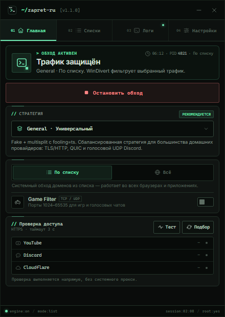

# Zapret RU

<p align="center">
  
</p>

<p align="center">
  <b>Терминальный лаунчер для оригинального zapret на Windows.</b><br>
  YouTube, Discord, QUIC и игровой UDP — без рекламы, аккаунтов и телеметрии.
</p>

<p align="center">
  <a href="https://github.com/GARAKIL/zapret-ru/releases/latest"></a>
  <a href="https://github.com/GARAKIL/zapret-ru/actions/workflows/ci.yml"></a>
  
  
  
  
  
</p>

<p align="center">
  <a href="https://github.com/GARAKIL/zapret-ru/releases/latest"><b>Скачать ZapretRU.exe</b></a>
  ·
  <a href="https://github.com/GARAKIL/zapret-ru">Репозиторий</a>
  ·
  <a href="https://github.com/GARAKIL/zapret-ru/releases">Все релизы</a>
</p>

<p align="center">
  
  
</p>

**Zapret RU** — компактный open-source лаунчер для Windows поверх оригинального
[bol-van/zapret](https://github.com/bol-van/zapret). Не VPN, не прокси, не
подписка. Трафик остаётся на вашем компьютере; приложение лишь запускает и
останавливает `winws.exe` с выбранной desync-стратегией.

> Проект не связан с bol-van и не распространяет бинарники zapret. Компоненты
> `winws.exe`, WinDivert, `cygwin1.dll` и `.bin`-файлы нужно взять из
> официального дистрибутива zapret.

> **Честно о «100%»:** ни один локальный обход DPI не работает на 100% у всех
> провайдеров и не пробивает блокировки по IP, подмену DNS или VPN-протоколы.
> Для разных ТСПУ нужны разные пресеты. Встроенный автоподбор помогает найти
> рабочую стратегию именно для вашего подключения.

## Скачать и запустить

1. Скачайте `ZapretRU.exe` из раздела **Releases** этого репозитория.
2. Положите рядом папку `bin` из официального Windows-дистрибутива zapret
   (`winws.exe`, `WinDivert.dll`, `WinDivert64.sys`, `cygwin1.dll`).
3. Запустите exe, разрешите UAC и нажмите **«Запустить обход»**.

Если что-то не открывается — нажмите **«Подбор»**: лаунчер проверит все
стратегии и оставит рабочую. Готовые сборки с исходников собираются через
`build.bat`; ничего, кроме официального zapret и WebView2 Runtime, приложение
само не скачивает.

---

## Что умеет

- **Автоподбор стратегии** — по одной кнопке проверяет все 5 пресетов по
  YouTube, Discord и Cloudflare, выбирает лучший по доступности и задержке и
  оставляет его активным.
- **Два системных режима обхода**
  - **По списку** — desync только для доменов из `lists/list-general.txt`,
    работает во всех браузерах и программах.
  - **Всё** — TCP 80/443 и UDP 443 для любого процесса, кроме доменов из
    `lists/list-exclude.txt`.
- **Game Filter** — дополнительно включает TCP/UDP-порты 1024–65535 для игр и
  голосовых чатов.
- **Голос Discord** — отдельный UDP-профиль для портов 19294–19344 и
  50000–65535, с фильтром протоколов discord/stun.
- **QUIC** — отдельный UDP 443-профиль (YouTube и другие сервисы).
- **5 стратегий** в `presets.json`: fake + multisplit, fakedsplit + autottl +
  badseq, split2 + md5sig, syndata + aggressive, только split без fake.
- **Проверка доступа** — параллельные HTTPS-запросы к YouTube, Discord и
  Cloudflare с таймаутом 3 секунды.
- **Живые логи** stdout/stderr winws с цветными уровнями, копированием и
  отображением фактической команды запуска.
- **Редактор списков** с подсчётом доменов, атомарным сохранением и резервной
  копией `.bak`. winws перечитывает изменённый список самостоятельно.
- **Системный трей**: открыть окно, запустить/остановить обход, проверить
  доступ, выйти.
- **Автозапуск** при входе в Windows через задачу планировщика с повышенными
  правами (`schtasks`, ONLOGON, HIGHEST).
- **Локальная статистика**: запуски, сессии обхода и время использования.
  Считается только на этом ПК, никуда не отправляется.
- **Безопасное завершение winws**: `CREATE_NO_WINDOW`, захват вывода,
  `terminate`, резервный `taskkill /F /T /PID`, `atexit`.
- **Прозрачность**: нет рекламы, телеметрии, автоскачивания кода, фоновых
  соединений и скрытых команд. Диагностика обращается в сеть только после
  нажатия кнопки.

## Что значит «на все программы»

`winws` перехватывает трафик на уровне ОС через WinDivert, а не хукает
отдельные приложения. Поэтому режим **«Всё»** действует на любой процесс,
который использует TCP 80/443 или UDP 443, а режим списка — на эти домены в
любом браузере/клиенте.

Это не даёт магических 100% на любом ПК: стратегии зависят от регионального
ТСПУ, маршрута, DNS и конкретного сервиса. Приложение не может ускорить
соединение относительно прямого канала; оно не является прокси и не добавляет
плечо маршрутизации. Задержки в диагностике показывают реальные HTTPS-ответы.

---

## Требования

- Windows 10/11 **x64**.
- Права администратора (WinDivert).
- WebView2 Runtime — обычно уже установлен в Windows 10/11. Если нет:
  <https://developer.microsoft.com/microsoft-edge/webview2/>.
- Оригинальные файлы zapret для Windows в папке `bin`.
- Для запуска из исходников: **Python 3.11+ x64**.

---

## Быстрый старт из исходников

```powershell
cd E:\ZapretRU

python -m venv .venv
.\.venv\Scripts\Activate.ps1
python -m pip install -r requirements.txt

python main.py
```

Приложение запросит UAC и запустится от имени администратора.

### Файлы zapret в `bin`

Скопируйте `bin` из официального дистрибутива:

- <https://github.com/bol-van/zapret>
- <https://github.com/bol-van/zapret-win-bundle>

Обязательные файлы:

| Файл | Назначение |
|---|---|
| `winws.exe` | Движок desync из zapret |
| `WinDivert.dll` | WinDivert userspace |
| `WinDivert64.sys` | Драйвер перехвата для x64 |
| `cygwin1.dll` | Cygwin runtime для winws |

Рекомендуемые `.bin`-файлы:

| Файл | Назначение |
|---|---|
| `quic_initial_www_google_com.bin` | фейковый QUIC Initial |
| `tls_clienthello_www_google_com.bin` | фейковый TLS ClientHello |
| `ACTIVE_DISCORD_UDP.bin` | фейк для Discord/STUN |
| `ACTIVE_GAME_UDP.bin` | фейк для игрового UDP |

Если `.bin`-файла нет, приложение **не падает**: соответствующий аргумент
пропускается, и winws использует встроенный фейк. В интерфейсе появляется
аккуратное уведомление. Для стабильного обхода лучше положить полный комплект.

> Используйте только официальные источники. Сторонние архивы с winws и
> WinDivert могут содержать вредоносный код. Приложение ничего не скачивает
> само.

---

## Режимы обхода

### По списку (рекомендуется)

`--hostlist=lists/list-general.txt` плюс
`--hostlist-exclude=lists/list-exclude.txt`.

Обход применяется только к доменам из основного списка. Поддомены учитываются
автоматически. Голос Discord и Game Filter работают отдельными профилями.

Этот режим безопаснее: российские банки, Госуслуги, Яндекс, VK и локальные
сервисы не попадают под desync.

### Всё

Применяется ко всему TCP 80/443 и UDP 443, **кроме** доменов из
`list-exclude.txt`.

В базовом списке исключений уже есть строки:

```text
ru
xn--p1ai
```

- `ru` исключает все домены зоны `.ru` (поддомены учитываются автоматически).
- `xn--p1ai` — punycode зоны `.рф`.
- Дополнительно перечислены Госуслуги, налог, банки, Яндекс, VK, Mail.ru,
  Ozon, Wildberries, Avito и др.

Важно: исключения работают по SNI/Host. Трафик без имени домена, блокировки по
IP и zero-phase методы (`syndata`) не могут фильтроваться по hostlist. В режиме
«Всё» проверяйте российские сервисы после запуска.

### Game Filter

Добавляет в `--wf-tcp` / `--wf-udp` порты 1024–65535 и создаёт отдельные
профили с `--dpi-desync-any-protocol=1` и cutoff. Предназначен для игровых
серверов и голосовых чатов. Это сознательно широкий режим: если он мешает
другим UDP-приложениям, выключите его.

---

## Пресеты

Стратегии лежат в `presets.json` и строятся генератором
`core/presets.py`. В файле нет готовых команд с `--new`, `--filter-*` и
`--hostlist`: приложение само добавляет режим, порты, hostlist/exclude и
разделители профилей. Это защищает режимы «Список» и «Всё» от случайного
смешивания.

| id | Название | Метод |
|---|---|---|
| `general` | General — Универсальный | `fake,multisplit`, `fooling=ts`, QUIC + Discord UDP |
| `alt1` | ALT 1 — Badseq / Autottl | `fake,fakedsplit`, `autottl=2`, `fooling=badseq` |
| `alt2` | ALT 2 — Split2 / MD5Sig | `fake,split2`, `fooling=md5sig` |
| `alt3` | ALT 3 — Syndata / Агрессивный | `syndata,fake,multisplit`, badseq/autottl, увеличенные повторы |
| `alt4` | ALT 4 — Без Fake / Только Split | `multisplit` без fake-пакетов, `udplen` для UDP |

`split2` в актуальном winws является совместимым синонимом `multisplit`.

Рекомендуемый порядок проверки: **General → ALT 1 → ALT 2 → ALT 4 → ALT 3**.
Выбор зависит от провайдера и ТСПУ. Если стратегия перестала работать,
провайдер мог изменить фильтрацию.

### Как редактировать presets.json

Каждый пресет содержит блоки:

```json
{
  "id": "general",
  "name": "General",
  "label": "Универсальный",
  "description": "...",
  "caution": null,
  "quic": ["--dpi-desync=fake", "..."],
  "discord": ["..."],
  "tcp": ["..."],
  "game_tcp": ["..."],
  "game_udp": ["..."]
}
```

- `@BIN/name.bin` заменяется на абсолютный путь к `bin/name.bin`.
- Если файла нет, аргумент пропускается.
- Аргументы с `--new`, `--filter-*`, `--wf-*`, `--hostlist*` запрещены: это
  зона генератора.
- После изменения нажмите «Обновить presets» в настройках или перезапустите
  приложение.

---

## Диагностика и автоподбор

Кнопка **«Тест»** выполняет три прямых HTTPS-запроса параллельно:

- YouTube: `https://www.youtube.com/generate_204`
- Discord: `https://discord.com/api/v10/gateway`
- Cloudflare: `https://www.cloudflare.com/cdn-cgi/trace`

Таймаут каждого запроса — 3 секунды. Системный прокси намеренно не
используется, чтобы проверять именно текущий маршрут с WinDivert.

Кнопка **«Подбор»** последовательно запускает все пресеты, ждёт инициализацию
winws, проверяет три сервиса и выбирает стратегию с максимальной доступностью и
минимальной задержкой. Это занимает около 30 секунд и на время проверки
перезапускает обход. Если ни одна стратегия не дала доступ, приложение
останавливает winws и возвращает исходный пресет.

Зелёный статус означает, что TLS-соединение и HTTP-ответ получены. Это быстрый
индикатор, а не гарантия, что все функции сервиса работают: DPI может
блокировать отдельные CDN, API или голосовые порты.

---

## Локальная статистика

В настройках отображаются:

- количество запусков лаунчера;
- количество сессий обхода;
- суммарное время в обходе;
- суммарное время в лаунчере;
- время текущей сессии в нижней status line.

Счётчики хранятся в `usage.json` рядом с настройками. **Они никогда не
отправляются в интернет.** Глобального «онлайн-счётчика пользователей» здесь
нет: для него потребовался бы сервер и сбор персональных запросов, что
противоречит принципам проекта. Публичная статистика скачиваний доступна
средствами GitHub Releases после публикации репозитория.

---

## Трей, закрытие и автозапуск

- Кнопка закрытия окна по умолчанию сворачивает приложение в трей.
- В меню трея доступны запуск/остановка, проверка доступа и выход.
- Автозапуск создаёт задачу планировщика **Zapret RU Launcher**:
  `ONLOGON`, `HIGHEST`, команда с флагом `--autostart`.
- При автозапуске лаунчер открывается свёрнутым в трей. Обход **не включается
  автоматически**: запустите его из окна или меню трея. Это осознанное решение,
  чтобы WinDivert не начинал перехват без явной команды.

Удалить задачу вручную:

```cmd
schtasks /Delete /TN "Zapret RU Launcher" /F
```

Если перенести exe в другую папку, выключите и включите автозапуск заново,
чтобы обновить путь в задаче.

---

## Сборка в один exe

Зависимости уже перечислены в `requirements.txt`; для воспроизводимой сборки
можно использовать зафиксированные версии из `requirements.lock`. Сборка —
нативно в машинный код через Nuitka:

```powershell
python -m pip install -r requirements.lock
build.bat
```

Результат: `dist\ZapretRU.exe` и `dist\SHA256SUMS.txt`.

Ключевые параметры сборки:

- `--onefile` — один exe.
- `--windows-console-mode=disable` — без консольного окна.
- `--windows-uac-admin` — манифест запрашивает администратора.
- `--python-flag=no_docstrings,no_asserts` — меньше служебных строк и
  отладочных проверок в native-сборке.
- `--include-data-dir=ui=ui`, `lists`, `assets` — ресурсы внутри exe.
- `--include-data-files=presets.json=presets.json`.
- `--include-package-data=webview`, `pythonnet`, `clr_loader` и явный
  `WebView2Loader.dll` — для корректного WebView2 и .NET.
- `--windows-icon-from-ico=assets/icon.ico`.

`tools/build_prepare.py` проверяет окружение, складывает WebView2Loader.dll в
`build_artifacts` и после успешной сборки пишет SHA-256 контрольную сумму.

### Что важно знать о сборке

- Nuitka компилирует Python в нативный код. Это не «шифрование» и не DRM:
  интерфейс и стратегии остаются прозрачными и редактируемыми. Абсолютной
  защиты от reverse engineering не существует; безопасность проекта строится на
  открытом коде, проверяемых релизах и SHA-256, а не на «антихакерских» трюках.
- Nuitka/pywebview — динамично развивающиеся пакеты. В `build.bat` уже добавлены
  явные WebView2 DLL и package data. Если после обновления pywebview появляется
  ошибка WebView2Loader, обновите Nuitka и пересоберите проект.
- Антивирусы и SmartScreen могут реагировать на WinDivert и упакованный
  onefile. Это типично для драйверов перехвата; подписанного сертификата у
  проекта нет.
- `bin` **не** вшивается в exe. `build.bat` копирует папку `bin` рядом с
  `dist\ZapretRU.exe`, если она есть в проекте. winws требует соседние DLL,
  поэтому так проще обновлять движок.

---

## Где хранятся данные

### Из исходников

- `lists/list-general.txt`
- `lists/list-exclude.txt`
- `presets.json`
- настройки: `settings.json` в корне проекта (создаётся при изменении)
- локальная статистика: `usage.json`

### В собранном onefile

- Ресурсы `ui`, `lists`, `presets.json` распаковываются Nuitka во временную
  папку.
- Редактируемая копия списков и `presets.json` создаётся в
  `%LOCALAPPDATA%\ZapretRU\`.
- Настройки, `usage.json` и `launcher.log` — там же.
- `bin` лежит рядом с `ZapretRU.exe` и используется напрямую.

Папку данных можно открыть из «Настройки → Данные».

---

## Ограничения

Zapret RU — не VPN и не прокси. Он не поможет, если:

- блокировка сделана по IP-адресу, а не по SNI/Host;
- провайдер подменяет DNS (настройте DoH/DoT или другой DNS);
- трафик проходит через полноценный реконструирующий прокси;
- блокируется протокол VPN/QUIC целиком на уровне маршрута;
- применяется активный DPI, который режет все варианты desync.

Стратегии не универсальны и могут требовать подбора. Оригинальный
`blockcheck\blockcheck.cmd` из zapret помогает найти рабочий набор параметров
для конкретного провайдера.

Не запускайте второй `winws.exe` параллельно: приложение обнаруживает чужой
процесс и просит остановить его, чтобы фильтры WinDivert не конфликтовали.

---

## Тесты и разработка

```powershell
python -m unittest discover -s tests -v
node --check ui/app.js
```

Сейчас 27 unit-тестов: сборка команд, режимы «список/всё», Game Filter,
валидация `presets.json`, настройки, сохранение списков, usage-статистика,
жизненный цикл тестового процесса и диагностика.

`tests/ui_preview.html` — необязательный dev-стенд интерфейса с mock API. В нём
можно проверить главную, списки, логи, настройки и автоподбор без реального
winws. Он не входит в сборку.

---

## Структура проекта

```text
main.py                 точка входа, UAC, окно, трей
core/
  manager.py            запуск/остановка winws, логи, taskkill, atexit
  presets.py            загрузка presets.json и генерация аргументов
  checker.py            параллельная HTTPS-диагностика
  application.py        сервисный слой для UI и трея
  environment.py        проверка bin, списков и сторонних winws
  settings.py           валидация и атомарное сохранение настроек
  usage.py              локальная статистика без сети
  autostart.py          schtasks
  tray.py               pystray + Pillow
  winutils.py           UAC, буфер обмена, проводник
ui/
  index.html            разметка и SVG-иконки
  style.css             терминальная тёмная тема, Inter + mono
  app.js                состояние UI, API-мост, логи, диагностика, автоподбор
  fonts/                Inter (OFL) локально, без Google Fonts в рантайме
bin/                    winws.exe, WinDivert, cygwin1.dll, .bin
lists/                  list-general.txt, list-exclude.txt
presets.json            стратегии
assets/                 иконки приложения
docs/                   скриншоты, social preview, release notes
tools/                  подготовка сборки и публикации
.github/                CI, release workflow, issue templates, security setup
build.bat               сборка Nuitka + SHA-256
tests/                  unit-тесты и dev preview
SECURITY.md             модель угроз и порядок сообщения об уязвимостях
CONTRIBUTING.md         правила разработки
```

---

## Безопасность и приватность

- Приложение не содержит сетевого клиента, кроме трёх диагностических
  HTTPS-запросов, которые выполняются только по нажатию кнопки.
- Нет рекламы, аналитики, автообновлений и загрузки стратегий из интернета.
- Вся статистика использования локальная; данные не покидают ПК.
- Все команды winws видны в логах и в блоке «Команда запуска».
- Никаких скрытых процессов: запускается только один `winws.exe`, PID которого
  известен менеджеру. Завершение выполняется по этому PID, а не по имени образа.
- Открытие ссылок разрешено только на официальные страницы zapret/WebView2.
- Аргументы пресетов валидируются; запуск процессов происходит без shell.
- CSP в HTML запрещает загрузку внешних скриптов, стилей, картинок и сетевые
  `fetch` из UI. Локальный `'unsafe-eval'` разрешён только потому, что его
  требует JS-мост PyWebView; удалённого кода в интерфейсе нет.
- Ограничение честное: локальный администратор может исследовать и изменить
  любой неподписанный клиент. Абсолютной защиты от reverse engineering не
  существует. Подробнее — в [SECURITY.md](SECURITY.md) и [docs/SIGNING.md](docs/SIGNING.md).

---

## Репозиторий и релизы

- Репозиторий: <https://github.com/GARAKIL/zapret-ru>
- Релизы: <https://github.com/GARAKIL/zapret-ru/releases>
- Текущий релиз: **v1.1.0** с `ZapretRU.exe` и `SHA256SUMS.txt`.

В проекте настроены:

- `.github/workflows/ci.yml` — тесты на каждый push/PR;
- `.github/workflows/release.yml` — сборка onefile по тегу `v*` и публикация
  `ZapretRU.exe` + `SHA256SUMS.txt` в GitHub Releases;
- `.github/workflows/codeql.yml` — статический анализ Python и JS;
- `.github/dependabot.yml` — контроль обновлений зависимостей;
- `SECURITY.md`, `CONTRIBUTING.md`, шаблоны issue/PR;
- `.github/REPO_SETUP.md` — рекомендованное описание и GitHub Topics:
  `zapret`, `dpi-bypass`, `anti-censorship`, `windows`, `russia`, `tspu`,
  `youtube`, `discord`, `quic`, `windivert`, `pywebview`, `nuitka`, `desync`,
  `network`, `gui`;
- `tools/publish_github.ps1` — создание публичного репозитория, topic-тегов,
  отправка кода и тега после `gh auth login`.

Перед запуском exe из Release проверяйте SHA-256:

```powershell
Get-FileHash .\ZapretRU.exe -Algorithm SHA256
Get-Content .\SHA256SUMS.txt
```

Бинарники zapret намеренно не хранятся в репозитории и не вшиваются в exe.

---

## Лицензии и благодарности

- **zapret** — [bol-van/zapret](https://github.com/bol-van/zapret). Оригинальный
  проект и его бинарники распространяются отдельно под лицензией zapret.
- **zapret-win-bundle** — официальная Windows-сборка:
  [bol-van/zapret-win-bundle](https://github.com/bol-van/zapret-win-bundle).
- **PyWebView**, **pystray**, **Pillow**, **pythonnet**, **Nuitka** — их
  авторам и сообществам.
- **Inter** — Rasmus Andersson, SIL Open Font License 1.1.
  См. `ui/fonts/Inter-LICENSE.txt`.

Код лаунчера — MIT, см. `LICENSE`.

Если проект помог, поставьте звезду и расскажите о нём. Это помогает найти
проект другим пользователям. Реклама, платные подписки и телеметрия в проекте
не появятся.

---

## Правовая оговорка

Используйте инструмент ответственно и в рамках применимого законодательства.
Обход DPI может нарушать условия оказания услуг провайдера. Авторы не несут
ответственности за блокировки, потерю доступа или иные последствия применения
сторонних бинарников zapret.

---

## Ключевые слова

`zapret для Windows` · `обход блокировок YouTube` · `Discord` · `QUIC` ·
`ТСПУ` · `DPI bypass` · `anti-censorship` · `WinDivert` · `winws` ·
`zapret YouTube` · `zapret Discord` · `desync` · `Windows 10/11` · `open source` ·
`без рекламы` · `без телеметрии`.
